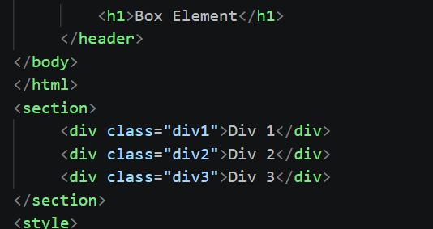
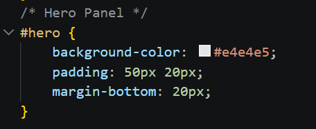
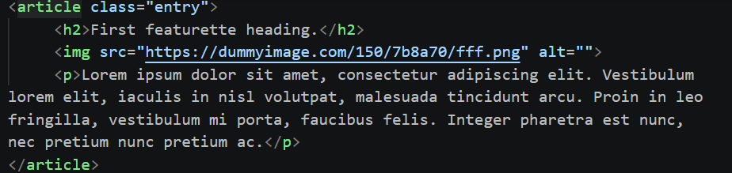
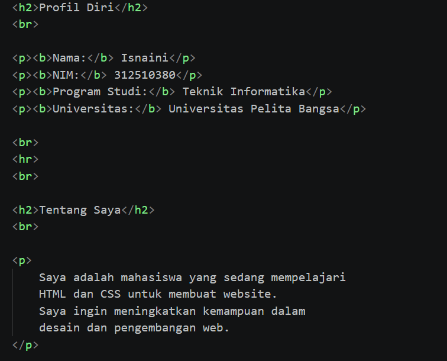
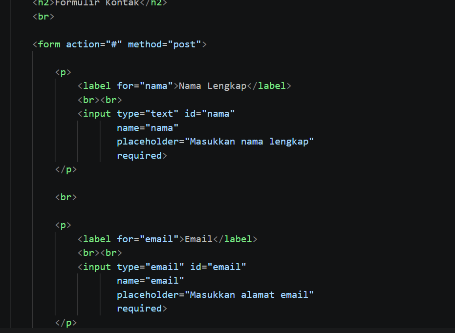

# lab4_box_html
## 1. Box elemnt
Mempelajari struktur box element pada HTML yang terdiri dari margin, border, padding, dan content.

## 2. Float property
Menggunakan properti float untuk membuat elemen berjajar secara horizontal.

## 3. Clearfix Elemnt
Menggunakan properti clear untuk mengatur posisi elemen setelah elemen float.

## 4. layout website sederhana

## 5. Header 
mengatur ukuran dan tampilan header 

## 6.Navigasi
mengatur menu home,artikel,about,dan kontak 

## 7. Hero panel
mengatur bagian hero yang berada di bawah navigasi website

## 8. Main Content sidebar
mengatur posisi konten utama dan sidebar agar tersusun rapi

## 9.footer
membuat bagian footer yang terletak di bawah halaman website

## 10. content artikel
menambahkan artikel yang berisi judul,gambar,dan paragraf

## 11. halaman about
membuat halaman about yang berisi deskripsi diri dan portofolio

## 12. halaman contact
membuat halaman contact yang berisi formulir nama,email,dan pesan

